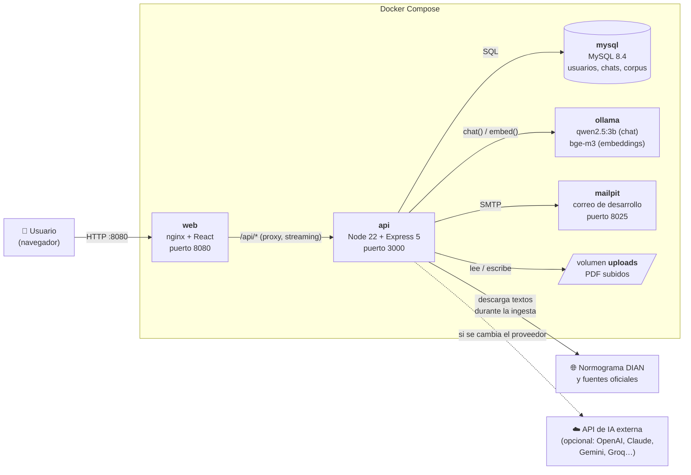
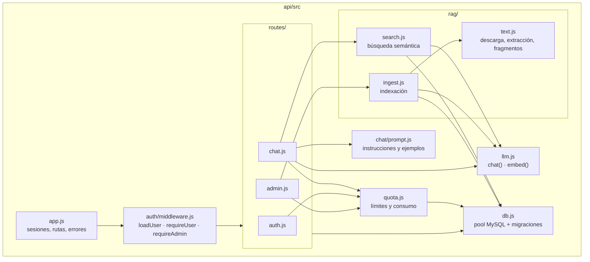
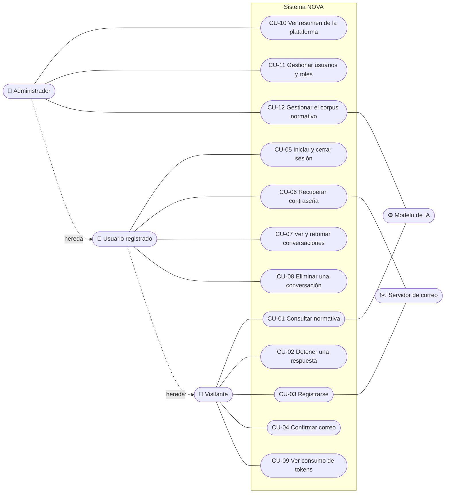
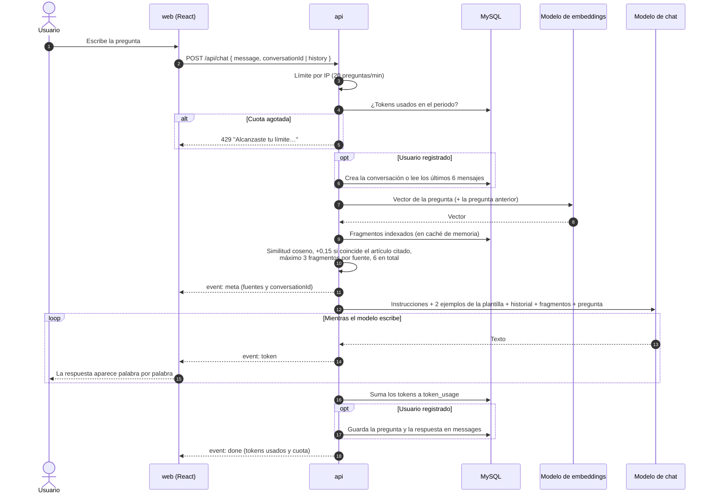
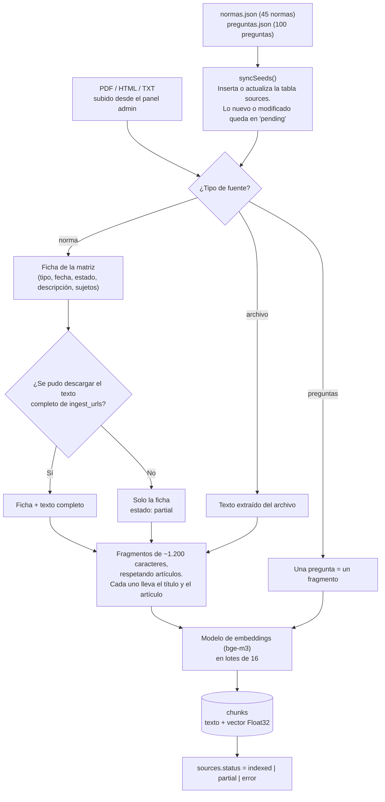
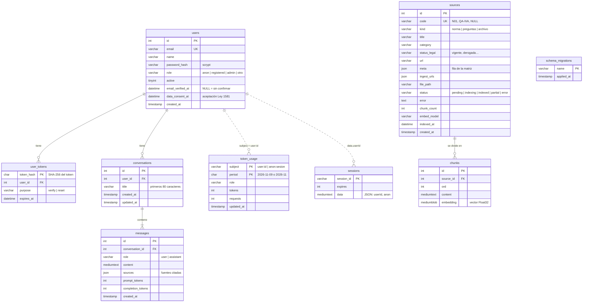

# NOVA

Chatbot de consulta sobre la normativa tributaria vigente en Colombia.

Consultorio Empresarial UDES | Proyecto PROP-DET07-26

---

## Contenido

1. [¿Qué es NOVA?](#qué-es-nova)
2. [Cómo funciona la plataforma](#cómo-funciona-la-plataforma)
   - [Arquitectura](#arquitectura)
   - [Tipos de usuario](#tipos-de-usuario)
   - [Casos de uso](#casos-de-uso)
   - [Flujo de una consulta](#flujo-de-una-consulta)
   - [Cómo aprende NOVA las normas (indexación)](#cómo-aprende-nova-las-normas-indexación)
   - [Base de datos](#base-de-datos)
3. [Documentación de la API](#documentación-de-la-api)
4. [Instalación y desarrollo](#instalación-y-desarrollo)

---

## ¿Qué es NOVA?

NOVA es un asistente conversacional que orienta a emprendedores, pequeños empresarios y estudiantes sobre la normativa tributaria colombiana. Responde preguntas en lenguaje natural sobre renta, IVA, retención en la fuente, facturación y nómina electrónica, información exógena, Régimen Simple, obligaciones formales y protección de datos.

Sus respuestas cumplen tres condiciones:

- **Se basan solo en normas oficiales.** NOVA conoce las 45 normas de la matriz normativa DIAN 2023-2026 (`api/data/normas.json`) y los documentos que el administrador agregue. No responde con conocimiento general del modelo de IA.
- **Siempre citan la norma.** Toda respuesta sigue el formato **Respuesta / Fuente** de la plantilla de 100 preguntas del Consultorio (`api/data/preguntas.json`), e indica la norma y el artículo de donde sale.
- **Respetan la vigencia.** Cada norma tiene un estado (vigente, derogada, histórica, no vigente). NOVA advierte cuando una norma ya no está vigente y la interfaz la marca en la lista de fuentes.

El modelo de IA corre en local con Ollama, así que las preguntas de los usuarios no salen del equipo. También se puede cambiar por un servicio de pago editando solo el `.env`.

---

## Cómo funciona la plataforma

### Arquitectura

NOVA está formada por cinco contenedores Docker. El usuario solo se conecta al contenedor `web`, que sirve la interfaz y reenvía las peticiones `/api` al backend.



| Componente  | Tecnología                         | Responsabilidad                                                                                                                                            |
| ----------- | ---------------------------------- | ---------------------------------------------------------------------------------------------------------------------------------------------------------- |
| **web**     | React 18 + Vite, servido por nginx | Interfaz de chat, registro, inicio de sesión y panel admin. nginx reenvía `/api` a la API sin buffer, para que las respuestas lleguen palabra por palabra. |
| **api**     | Node 22 + Express 5                | Autenticación y sesiones, chat con RAG, cuotas de tokens, ingesta del corpus y panel admin. Aplica las migraciones de la base de datos al arrancar.        |
| **mysql**   | MySQL 8.4                          | Guarda usuarios, sesiones, conversaciones, consumo de tokens y el corpus (fragmentos de texto y sus vectores).                                             |
| **ollama**  | Ollama                             | Ejecuta en local el modelo de chat y el de embeddings. Es opcional: se puede usar cualquier API compatible con OpenAI.                                     |
| **mailpit** | Mailpit                            | Bandeja de correo falsa para desarrollo. En producción se reemplaza por el SMTP institucional.                                                             |

Dentro de la API, el código se organiza por módulos:



### Tipos de usuario

| Rol                             | Cómo se obtiene                                               | Qué puede hacer                                                  | Historial                                               | Cuota por defecto                                           |
| ------------------------------- | ------------------------------------------------------------- | ---------------------------------------------------------------- | ------------------------------------------------------- | ----------------------------------------------------------- |
| `anon` (visitante)              | Entra sin cuenta                                              | Hacer preguntas                                                  | Solo en la pestaña del navegador; se pierde al recargar | 20.000 tokens al día (unas 5 a 8 preguntas)                 |
| `registered`                    | Se registra, acepta la política de datos y confirma su correo | Todo lo anterior, y guardar, retomar y borrar sus conversaciones | Guardado en la base de datos                            | 200.000 tokens al día                                       |
| `admin`                         | Se crea desde el `.env` o un admin le asigna el rol           | Todo lo anterior, y entrar al panel admin                        | Guardado                                                | Ilimitada                                                   |
| Roles nuevos (p. ej. `docente`) | Un admin escribe el rol en el panel                           | Lo mismo que un registrado                                       | Guardado                                                | `QUOTA_<ROL>` en el `.env`; si no existe, la de registrados |

### Casos de uso



| Código | Caso de uso                  | Actor              | Descripción                                                                                                                   | Resultado                                                                       |
| ------ | ---------------------------- | ------------------ | ----------------------------------------------------------------------------------------------------------------------------- | ------------------------------------------------------------------------------- |
| CU-01  | Consultar normativa          | Todos              | El usuario escribe una pregunta. NOVA busca los fragmentos de norma relevantes y el modelo redacta la respuesta en streaming. | Respuesta con formato **Respuesta / Fuente** y lista de fuentes consultadas     |
| CU-02  | Detener una respuesta        | Todos              | El usuario pulsa "Detener" mientras NOVA escribe.                                                                             | Se corta la generación; lo ya escrito se conserva y se cobra solo lo generado   |
| CU-03  | Registrarse                  | Visitante          | Ingresa nombre, correo y contraseña, y acepta la política de datos (Ley 1581 de 2012).                                        | Cuenta creada sin confirmar y correo de verificación enviado                    |
| CU-04  | Confirmar correo             | Visitante          | Abre el enlace del correo (válido 48 horas). Puede pedir que se lo reenvíen.                                                  | Cuenta habilitada para iniciar sesión                                           |
| CU-05  | Iniciar y cerrar sesión      | Registrado         | Ingresa con correo y contraseña.                                                                                              | Sesión en MySQL con la cookie `nova.sid`                                        |
| CU-06  | Recuperar contraseña         | Registrado         | Pide un enlace por correo (válido 1 hora) y define una contraseña nueva.                                                      | Contraseña actualizada                                                          |
| CU-07  | Ver y retomar conversaciones | Registrado         | Abre una conversación de la barra lateral y continúa preguntando con ese contexto.                                            | Historial cargado; NOVA tiene en cuenta los últimos 6 mensajes                  |
| CU-08  | Eliminar una conversación    | Registrado         | Borra una conversación de la barra lateral.                                                                                   | Conversación y mensajes eliminados                                              |
| CU-09  | Ver consumo de tokens        | Todos (con límite) | Debajo de la caja de texto ve cuántos tokens lleva y su límite.                                                               | Si supera el límite, las siguientes preguntas se bloquean hasta el otro periodo |
| CU-10  | Ver resumen                  | Administrador      | Consulta usuarios por rol, consumo del periodo, estado del corpus y modelos configurados.                                     | Panorama general de la plataforma                                               |
| CU-11  | Gestionar usuarios y roles   | Administrador      | Busca usuarios, cambia su rol (o crea uno nuevo) y activa o desactiva cuentas.                                                | El cambio aplica de inmediato, aunque el usuario tenga la sesión abierta        |
| CU-12  | Gestionar el corpus          | Administrador      | Sube PDF, HTML o TXT; indexa pendientes; reindexa todo o una fuente; elimina archivos subidos.                                | NOVA usa los documentos nuevos en sus respuestas                                |

### Flujo de una consulta

NOVA usa **RAG** (generación aumentada con recuperación): antes de responder, busca en el corpus los fragmentos de norma más parecidos a la pregunta y se los entrega al modelo junto con las instrucciones. El modelo solo puede responder con esos fragmentos.



Las instrucciones del modelo (`api/src/chat/prompt.js`) le exigen:

1. Responder solo con el contexto entregado. Si no alcanza, debe decirlo y sugerir consultar a la DIAN o a un contador.
2. Atender solo temas tributarios colombianos y de protección de datos.
3. Advertir cuando una norma no está vigente.
4. Indicar el año y el valor en pesos cuando use UVT.
5. Usar siempre el formato de la plantilla:

```markdown
**Respuesta:** respuesta directa, con la norma o cifra clave en negrita.

**Fuente:** norma y artículo exactos.
```

### Cómo aprende NOVA las normas (indexación)

El conocimiento de NOVA se carga una vez (y cada vez que cambia) con la **ingesta**. Se ejecuta con `npm run ingest` o desde el panel admin.



| Estado                   | Significado                                 | Qué hacer                                                        |
| ------------------------ | ------------------------------------------- | ---------------------------------------------------------------- |
| `pending`                | Nueva o modificada, falta indexar           | Correr la ingesta o "Indexar pendientes"                         |
| `indexing`               | Se está indexando                           | Esperar                                                          |
| `indexed`                | Ficha y texto completo indexados            | Nada                                                             |
| `partial` ("Solo ficha") | No se pudo descargar el texto completo      | Subir el PDF desde el panel admin                                |
| `error`                  | Falló la indexación (p. ej. Ollama apagado) | Revisar el error en el panel; se reintenta en la próxima ingesta |

### Base de datos

La base de datos `nova` tiene 8 tablas. Las migraciones están en `api/src/migrations/` y se aplican solas al arrancar la API. La tabla `sessions` la crea la librería `express-mysql-session`.



| Tabla                        | Para qué sirve                                                                                                                                       |
| ---------------------------- | ---------------------------------------------------------------------------------------------------------------------------------------------------- |
| `users`                      | Cuentas de usuario. El rol es texto libre para poder crear tipos de usuario sin cambiar la base de datos. Guarda cuándo aceptó la política de datos. |
| `user_tokens`                | Enlaces de un solo uso para confirmar el correo (48 h) y restablecer la contraseña (1 h). Solo se guarda el hash, nunca el token.                    |
| `sessions`                   | Sesiones activas. Permiten varios usuarios a la vez y sobreviven a reinicios de la API.                                                              |
| `conversations` / `messages` | Historial de chat de los usuarios registrados, con las fuentes citadas y los tokens de cada respuesta. Se borran en cascada con el usuario.          |
| `token_usage`                | Tokens y preguntas por usuario (o sesión anónima) en cada día o mes. Con ella se aplican las cuotas.                                                 |
| `sources`                    | Cada fuente de conocimiento: una norma de la matriz, un grupo de preguntas de referencia o un archivo subido.                                        |
| `chunks`                     | Fragmentos de texto de cada fuente con su vector, que es lo que se compara en cada búsqueda.                                                         |
| `schema_migrations`          | Registro de las migraciones ya aplicadas.                                                                                                            |

---

## Documentación de la API

### Antes de empezar

- **URL base:** `http://localhost:8080/api` (a través de nginx). En desarrollo sin Docker también responde en `http://localhost:3000/api`.
- **Formato:** las peticiones y respuestas son JSON (`Content-Type: application/json`), salvo la subida de archivos (`multipart/form-data`) y el chat (Server-Sent Events).
- **Autenticación por sesión:** no se usan tokens en el encabezado. Al iniciar sesión, la API devuelve la cookie `nova.sid`, que se debe enviar en las siguientes peticiones. Thunder Client y Postman la guardan solos; con `curl` usa `-c cookies.txt` para guardarla y `-b cookies.txt` para enviarla.
- **Errores:** todos tienen la forma `{ "error": "mensaje" }`.

| Código                | Significado                                                          |
| --------------------- | -------------------------------------------------------------------- |
| `200` / `201` / `202` | Correcto / creado / aceptado (se procesa en segundo plano)           |
| `400`                 | Datos inválidos                                                      |
| `401`                 | Debes iniciar sesión                                                 |
| `403`                 | Sin permiso (no es admin, cuenta desactivada o correo sin confirmar) |
| `404`                 | No existe                                                            |
| `409`                 | Conflicto (correo ya registrado o indexación en curso)               |
| `429`                 | Demasiadas peticiones o cuota de tokens agotada                      |
| `503`                 | El modelo de IA no está disponible                                   |

**Ejemplo rápido con curl:**

```bash
# Iniciar sesión y guardar la cookie
curl -c cookies.txt -H "Content-Type: application/json" \
  -d '{"email":"admin@nova.local","password":"tu_clave"}' \
  http://localhost:8080/api/auth/login

# Preguntar usando la cookie (-N muestra el streaming a medida que llega)
curl -N -b cookies.txt -H "Content-Type: application/json" \
  -d '{"message":"¿Cuál es el valor de la UVT para 2026?"}' \
  http://localhost:8080/api/chat
```

### Resumen de endpoints

| #   | Método | Ruta                             | Acceso              |
| --- | ------ | -------------------------------- | ------------------- |
| 1.1 | GET    | `/api/health`                    | Público             |
| 2.1 | GET    | `/api/auth/me`                   | Público             |
| 2.2 | POST   | `/api/auth/register`             | Público             |
| 2.3 | POST   | `/api/auth/verify`               | Público             |
| 2.4 | POST   | `/api/auth/resend-verification`  | Público             |
| 2.5 | POST   | `/api/auth/login`                | Público             |
| 2.6 | POST   | `/api/auth/logout`               | Público             |
| 2.7 | POST   | `/api/auth/forgot`               | Público             |
| 2.8 | POST   | `/api/auth/reset`                | Público             |
| 3.1 | POST   | `/api/chat`                      | Público (con cuota) |
| 3.2 | GET    | `/api/chat/conversations`        | Registrado          |
| 3.3 | GET    | `/api/chat/conversations/:id`    | Registrado (dueño)  |
| 3.4 | DELETE | `/api/chat/conversations/:id`    | Registrado (dueño)  |
| 4.1 | GET    | `/api/admin/stats`               | Admin               |
| 4.2 | GET    | `/api/admin/users`               | Admin               |
| 4.3 | PATCH  | `/api/admin/users/:id`           | Admin               |
| 4.4 | GET    | `/api/admin/sources`             | Admin               |
| 4.5 | POST   | `/api/admin/sources/upload`      | Admin               |
| 4.6 | POST   | `/api/admin/sources/reindex`     | Admin               |
| 4.7 | POST   | `/api/admin/sources/:id/reindex` | Admin               |
| 4.8 | DELETE | `/api/admin/sources/:id`         | Admin               |

### 1. Estado del servicio

**1.1. Verificar que la API funciona**

- **URL:** `http://localhost:8080/api/health`
- **Método:** `GET`
- **Acceso:** público
- **Descripción:** comprueba que la API está arriba y conectada a MySQL.
- **Respuesta `200`:**

  ```json
  { "ok": true }
  ```

### 2. Autenticación

Los endpoints que envían correos o reciben contraseñas (2.2, 2.3, 2.4, 2.5, 2.7 y 2.8) aceptan como máximo 30 intentos cada 15 minutos por IP (`AUTH_RATE_LIMIT`).

**2.1. Usuario actual y cuota**

- **URL:** `http://localhost:8080/api/auth/me`
- **Método:** `GET`
- **Acceso:** público
- **Descripción:** devuelve el usuario de la sesión (o `null` si es anónimo), su rol y su consumo de tokens en el periodo. `limit = 0` significa ilimitado.
- **Respuesta `200`:**

  ```json
  {
    "user": {
      "id": 3,
      "email": "ana@correo.com",
      "name": "Ana Pérez",
      "role": "registered"
    },
    "role": "registered",
    "quota": {
      "period": "day",
      "limit": 200000,
      "used": 12450,
      "remaining": 187550
    }
  }
  ```

**2.2. Registrarse**

- **URL:** `http://localhost:8080/api/auth/register`
- **Método:** `POST`
- **Acceso:** público
- **Data:** body
- **Descripción:** crea una cuenta sin confirmar y envía el correo de verificación. `consent` debe ser `true` (aceptación de la política de datos, Ley 1581). La contraseña debe tener entre 8 y 200 caracteres.
- **Ejemplo:**

  ```json
  {
    "name": "Ana Pérez",
    "email": "ana@correo.com",
    "password": "ClaveSegura2026",
    "consent": true
  }
  ```

- **Respuesta `201`:** `{ "message": "Cuenta creada. Revisa tu correo para confirmarla." }`
- **Errores:** `400` (datos inválidos o sin consentimiento), `409` (el correo ya está registrado).

**2.3. Confirmar correo**

- **URL:** `http://localhost:8080/api/auth/verify`
- **Método:** `POST`
- **Acceso:** público
- **Data:** body
- **Descripción:** confirma el correo con el token del enlace (`/verificar?token=…`). El token sirve una sola vez y vence a las 48 horas.
- **Ejemplo:**

  ```json
  { "token": "3f9c1a…" }
  ```

- **Respuesta `200`:** `{ "message": "Correo confirmado. Ya puedes iniciar sesión." }`
- **Errores:** `400` (enlace inválido o vencido).

**2.4. Reenviar el correo de verificación**

- **URL:** `http://localhost:8080/api/auth/resend-verification`
- **Método:** `POST`
- **Acceso:** público
- **Data:** body
- **Descripción:** envía un enlace nuevo si la cuenta existe y no está confirmada. Siempre responde lo mismo, para no revelar qué correos están registrados.
- **Ejemplo:**

  ```json
  { "email": "ana@correo.com" }
  ```

- **Respuesta `200`:** `{ "message": "Si la cuenta existe y no está confirmada, te enviamos un nuevo enlace." }`

**2.5. Iniciar sesión**

- **URL:** `http://localhost:8080/api/auth/login`
- **Método:** `POST`
- **Acceso:** público
- **Data:** body
- **Descripción:** inicia sesión y devuelve la cookie `nova.sid`. Crea una sesión nueva en cada inicio de sesión (protección contra fijación de sesión).
- **Ejemplo:**

  ```json
  { "email": "ana@correo.com", "password": "ClaveSegura2026" }
  ```

- **Respuesta `200`:**

  ```json
  {
    "user": {
      "id": 3,
      "email": "ana@correo.com",
      "name": "Ana Pérez",
      "role": "registered"
    }
  }
  ```

- **Errores:** `401` (correo o contraseña incorrectos), `403` (cuenta desactivada, o correo sin confirmar; en ese caso incluye `"needsVerification": true`).

**2.6. Cerrar sesión**

- **URL:** `http://localhost:8080/api/auth/logout`
- **Método:** `POST`
- **Acceso:** público
- **Descripción:** destruye la sesión y borra la cookie.
- **Respuesta `200`:** `{ "ok": true }`

**2.7. Olvidé mi contraseña**

- **URL:** `http://localhost:8080/api/auth/forgot`
- **Método:** `POST`
- **Acceso:** público
- **Data:** body
- **Descripción:** envía un enlace para restablecer la contraseña, válido por 1 hora. Siempre responde lo mismo, exista o no la cuenta.
- **Ejemplo:**

  ```json
  { "email": "ana@correo.com" }
  ```

- **Respuesta `200`:** `{ "message": "Si el correo está registrado, te enviamos un enlace para restablecer la contraseña." }`

**2.8. Restablecer contraseña**

- **URL:** `http://localhost:8080/api/auth/reset`
- **Método:** `POST`
- **Acceso:** público
- **Data:** body
- **Descripción:** define la contraseña nueva con el token del enlace (`/restablecer?token=…`). Si el correo no estaba confirmado, también lo confirma.
- **Ejemplo:**

  ```json
  { "token": "8b2e7d…", "password": "NuevaClave2026" }
  ```

- **Respuesta `200`:** `{ "message": "Contraseña actualizada. Ya puedes iniciar sesión." }`
- **Errores:** `400` (contraseña inválida, o enlace inválido o vencido).

### 3. Chat

**3.1. Hacer una pregunta**

- **URL:** `http://localhost:8080/api/chat`
- **Método:** `POST`
- **Acceso:** público, con cuota de tokens y máximo 20 preguntas por minuto por IP (`CHAT_RATE_LIMIT`)
- **Data:** body
- **Descripción:** envía una pregunta (máximo 2.000 caracteres) y recibe la respuesta en streaming. Cambia según el tipo de usuario:
  - **Registrado:** sin `conversationId` se crea una conversación nueva; con `conversationId` se continúa una existente. La API lee el historial de la base de datos.
  - **Anónimo:** no se guarda nada. El navegador manda el historial en `history` (la API usa los últimos 6 mensajes).
- **Ejemplo (registrado):**

  ```json
  {
    "message": "¿Quiénes están obligados a facturar electrónicamente?",
    "conversationId": 12
  }
  ```

- **Ejemplo (anónimo):**

  ```json
  {
    "message": "¿Y para personas jurídicas?",
    "history": [
      {
        "role": "user",
        "content": "¿Cuál es la tarifa de renta para personas naturales?"
      },
      { "role": "assistant", "content": "**Respuesta:** …" }
    ]
  }
  ```

- **Respuesta `200`:** `Content-Type: text/event-stream`, con estos eventos en orden:

  | Evento  | Cuándo                               | Datos                                                                                          |
  | ------- | ------------------------------------ | ---------------------------------------------------------------------------------------------- |
  | `meta`  | Al empezar                           | `conversationId` (`null` si es anónimo) y `sources` (fuentes encontradas, con su estado legal) |
  | `token` | Varias veces                         | `t`: un pedazo del texto de la respuesta                                                       |
  | `done`  | Al terminar                          | `messageId`, `usage` (tokens de entrada y salida) y `quota` actualizada                        |
  | `error` | Si el modelo falla a mitad de camino | `error`: mensaje                                                                               |

  ```text
  event: meta
  data: {"conversationId":12,"sources":[{"title":"Resolución 000165 de 2023","url":"https://normograma.dian.gov.co/…","statusLegal":"vigente"}]}

  event: token
  data: {"t":"**Respuesta:** Están obligados"}

  event: token
  data: {"t":" a expedir factura electrónica…"}

  event: done
  data: {"messageId":58,"usage":{"prompt":2310,"completion":184},"quota":{"period":"day","limit":200000,"used":14944,"remaining":185056}}
  ```

- **Errores (antes de empezar el streaming):** `400` (pregunta vacía o muy larga), `404` (la conversación no es del usuario), `429` (cuota agotada o demasiadas preguntas por minuto), `503` (el modelo de embeddings no responde).
- **Detener:** si el cliente cierra la conexión, la API corta la generación, guarda lo que alcanzó a escribir y cobra solo esos tokens.

**3.2. Listar mis conversaciones**

- **URL:** `http://localhost:8080/api/chat/conversations`
- **Método:** `GET`
- **Acceso:** registrado
- **Descripción:** devuelve las últimas 100 conversaciones del usuario, de la más reciente a la más antigua.
- **Respuesta `200`:**

  ```json
  {
    "conversations": [
      {
        "id": 12,
        "title": "¿Quiénes están obligados a facturar electrónicamente?",
        "updatedAt": "2026-11-09T14:20:11.000Z"
      }
    ]
  }
  ```

**3.3. Abrir una conversación**

- **URL:** `http://localhost:8080/api/chat/conversations/:id`
- **Método:** `GET`
- **Acceso:** registrado, dueño de la conversación
- **Data:** params
- **Descripción:** devuelve la conversación con todos sus mensajes y las fuentes de cada respuesta.
- **Ej:** `http://localhost:8080/api/chat/conversations/12`
- **Respuesta `200`:**

  ```json
  {
    "conversation": {
      "id": 12,
      "title": "¿Quiénes están obligados a facturar electrónicamente?"
    },
    "messages": [
      {
        "id": 57,
        "role": "user",
        "content": "¿Quiénes están obligados…?",
        "sources": null,
        "createdAt": "…"
      },
      {
        "id": 58,
        "role": "assistant",
        "content": "**Respuesta:** …\n\n**Fuente:** …",
        "sources": [{ "title": "…", "url": "…", "statusLegal": "vigente" }],
        "createdAt": "…"
      }
    ]
  }
  ```

- **Errores:** `404` (no existe o no es del usuario).

**3.4. Eliminar una conversación**

- **URL:** `http://localhost:8080/api/chat/conversations/:id`
- **Método:** `DELETE`
- **Acceso:** registrado, dueño de la conversación
- **Data:** params
- **Descripción:** borra la conversación y todos sus mensajes.
- **Ej:** `http://localhost:8080/api/chat/conversations/12`
- **Respuesta `200`:** `{ "ok": true }`

### 4. Administración

Todos estos endpoints requieren una sesión con rol `admin`. Si no, responden `403 { "error": "Solo para administradores" }`.

**4.1. Resumen de la plataforma**

- **URL:** `http://localhost:8080/api/admin/stats`
- **Método:** `GET`
- **Descripción:** usuarios por rol, consumo de tokens del periodo por rol, estado del corpus, total de conversaciones y modelos configurados.
- **Respuesta `200`:**

  ```json
  {
    "period": "2026-11-09",
    "users": [
      { "role": "admin", "n": 1 },
      { "role": "registered", "n": 24 }
    ],
    "usage": [
      {
        "role": "registered",
        "tokens": 152300,
        "requests": 61,
        "subjects": 9,
        "limit": 200000
      }
    ],
    "corpus": [
      { "status": "indexed", "n": 38, "chunks": 5120 },
      { "status": "partial", "n": 17, "chunks": 17 }
    ],
    "conversations": 87,
    "indexing": false,
    "models": {
      "chat": "qwen2.5:3b",
      "chatUrl": "http://ollama:11434/v1",
      "embed": "bge-m3",
      "provider": "openai"
    }
  }
  ```

**4.2. Listar y buscar usuarios**

- **URL:** `http://localhost:8080/api/admin/users`
- **Método:** `GET`
- **Data:** query (`q`, opcional: busca por nombre o correo)
- **Descripción:** devuelve hasta 200 usuarios, con su consumo de tokens del periodo y su límite. Sin `q` devuelve todos.
- **Ej:** `http://localhost:8080/api/admin/users?q=ana`
- **Respuesta `200`:**

  ```json
  {
    "users": [
      {
        "id": 3,
        "email": "ana@correo.com",
        "name": "Ana Pérez",
        "role": "registered",
        "active": true,
        "verified": true,
        "createdAt": "…",
        "tokens": 12450,
        "limit": 200000
      }
    ]
  }
  ```

**4.3. Cambiar rol o activar/desactivar un usuario**

- **URL:** `http://localhost:8080/api/admin/users/:id`
- **Método:** `PATCH`
- **Data:** params y body (`role` y `active`, ambos opcionales)
- **Descripción:** cambia el rol (minúsculas, números o guion bajo; un rol nuevo crea un tipo de usuario) o activa y desactiva la cuenta. Aplica de inmediato. Un admin no puede modificarse a sí mismo.
- **Ej:** `http://localhost:8080/api/admin/users/3`

  ```json
  { "role": "docente", "active": true }
  ```

- **Respuesta `200`:** `{ "ok": true }`
- **Errores:** `400` (rol inválido, `anon`, o es tu propia cuenta), `404` (no existe).

**4.4. Listar fuentes del corpus**

- **URL:** `http://localhost:8080/api/admin/sources`
- **Método:** `GET`
- **Descripción:** lista todas las fuentes (normas, preguntas de referencia y archivos subidos) con su estado de indexación, número de fragmentos y el error si lo hubo.
- **Respuesta `200`:**

  ```json
  {
    "sources": [
      {
        "id": 1,
        "code": "N01",
        "kind": "norma",
        "title": "Decreto 1625 de 2016",
        "category": "Marco Normativo General",
        "statusLegal": "vigente",
        "url": "…",
        "status": "indexed",
        "error": null,
        "chunks": 1830,
        "embedModel": "bge-m3",
        "indexedAt": "…"
      }
    ],
    "indexing": false,
    "embedModel": "bge-m3"
  }
  ```

**4.5. Subir un documento**

- **URL:** `http://localhost:8080/api/admin/sources/upload`
- **Método:** `POST`
- **Data:** `multipart/form-data`

  | Campo      | Obligatorio | Descripción                                                             |
  | ---------- | ----------- | ----------------------------------------------------------------------- |
  | `file`     | Sí          | PDF con texto seleccionable, HTML, TXT o MD, hasta 25 MB                |
  | `title`    | No          | Título que se mostrará como fuente (por defecto, el nombre del archivo) |
  | `category` | No          | Categoría de la matriz (por defecto, `Marco Normativo General`)         |

- **Descripción:** guarda el archivo en el volumen `uploads`, lo registra como fuente `archivo` con estado legal `vigente` y lo indexa en segundo plano.
- **Ej. con curl:**

  ```bash
  curl -b cookies.txt -F "file=@resolucion.pdf" -F "title=Resolución 000XXX de 2026" -F "category=IVA" \
    http://localhost:8080/api/admin/sources/upload
  ```

- **Respuesta `201`:** `{ "id": 61 }`
- **Errores:** `400` (sin archivo o formato no permitido).

**4.6. Indexar pendientes o reindexar todo**

- **URL:** `http://localhost:8080/api/admin/sources/reindex`
- **Método:** `POST`
- **Data:** body
- **Descripción:** con `"all": false` (o sin body) indexa lo pendiente, lo que falló y lo indexado con otro modelo de embeddings. Con `"all": true` reindexa todo, por ejemplo después de cambiar el modelo de embeddings. Corre en segundo plano.
- **Ejemplo:**

  ```json
  { "all": true }
  ```

- **Respuesta `202`:** `{ "ok": true }`
- **Errores:** `409` (ya hay una indexación en curso).

**4.7. Reindexar una fuente**

- **URL:** `http://localhost:8080/api/admin/sources/:id/reindex`
- **Método:** `POST`
- **Data:** params
- **Descripción:** vuelve a indexar una sola fuente en segundo plano.
- **Ej:** `http://localhost:8080/api/admin/sources/15/reindex`
- **Respuesta `202`:** `{ "ok": true }`
- **Errores:** `404` (no existe).

**4.8. Eliminar un documento subido**

- **URL:** `http://localhost:8080/api/admin/sources/:id`
- **Método:** `DELETE`
- **Data:** params
- **Descripción:** elimina un archivo subido, sus fragmentos y el archivo del disco. Las normas de la matriz y las preguntas de referencia no se pueden eliminar desde la API: se editan en `api/data/`.
- **Ej:** `http://localhost:8080/api/admin/sources/61`
- **Respuesta `200`:** `{ "ok": true }`
- **Errores:** `400` (no es un archivo subido), `404` (no existe).

---

## Instalación y desarrollo

Esta sección es para quien instala o modifica NOVA.

### Estructura del repositorio

```
nova/
├── api/            Backend (Node + Express)
│   ├── data/           normas.json (matriz) y preguntas.json (100 preguntas de referencia)
│   └── src/
│       ├── migrations/   Archivos .sql que se aplican solos al arrancar
│       ├── llm.js        Proveedor de IA (chat y embeddings)
│       └── rag/          Ingesta del corpus y búsqueda
├── web/            Frontend (React + Vite)
└── docker-compose.yml
```

### Requisitos

- Docker Desktop (en Windows con WSL2 activado) o Docker Engine en Linux.
- Git.
- Node 22 solo si vas a desarrollar fuera de Docker.

### Arrancar con Docker

```bash
cp .env.example .env      # en Windows PowerShell: copy .env.example .env
# edita .env y cambia las contraseñas
docker compose up -d --build                                              # sin GPU
docker compose -f docker-compose.yml -f docker-compose.gpu.yml up -d --build   # con GPU NVIDIA
```

La primera vez, `ollama-pull` descarga los modelos (unos 3 GB). Para ver el avance: `docker compose logs -f ollama-pull`.

Abre http://localhost:8080.

Comandos útiles:

```bash
docker compose ps                 # ver qué está corriendo
docker compose logs -f api        # ver logs de la API
docker compose down               # apagar (conserva los datos)
docker compose down -v            # apagar y BORRAR la base de datos
```

### Desarrollo sin reconstruir contenedores

```bash
docker compose up -d mysql        # solo la base de datos
# en .env deja DB_HOST=localhost y publica el puerto agregando en docker-compose.yml, servicio mysql:
#   ports: ["3306:3306"]
cd api && npm install && npm run dev      # API en :3000 con recarga automática
cd web && npm install && npm run dev      # Web en :5173, reenvía /api a :3000
```

### Base de datos

Los cambios de esquema van en `api/src/migrations/NNN_nombre.sql`. Al arrancar, la API aplica en orden los que no se han aplicado y los registra en la tabla `schema_migrations`. Nunca edites una migración ya aplicada; crea una nueva.

### Usuarios y sesiones

| Tipo                   | Cómo se identifica                         | Historial    |
| ---------------------- | ------------------------------------------ | ------------ |
| `anon` (no registrado) | Cookie de sesión temporal                  | No se guarda |
| `registered`           | Correo + contraseña, correo confirmado     | Se guarda    |
| `admin`                | Igual que registrado, con `role = 'admin'` | Se guarda    |

- Las sesiones se guardan en la tabla `sessions` de MySQL (cookie `nova.sid`, `httpOnly`). Así varios usuarios pueden usar NOVA a la vez y las sesiones sobreviven a reinicios de la API.
- El rol es texto libre en `users.role`, así que puedes crear nuevos tipos de usuario sin cambiar la base de datos.
- El administrador inicial se crea al arrancar con `ADMIN_EMAIL` y `ADMIN_PASSWORD`.
- Registro: el usuario acepta la política de datos (Ley 1581), recibe un correo de confirmación (enlace válido 48 h) y solo después puede iniciar sesión. "Recuperar contraseña" envía un enlace válido 1 hora.
- La política de datos en `/privacidad` es un **borrador**: reemplázala por la oficial de la UDES.

### Pruebas de la API

Usan una base de datos aparte (`nova_test`) que se **borra** en cada corrida. Con MySQL publicado en el puerto 3306:

```bash
docker compose exec mysql mysql -uroot -p -e "CREATE DATABASE nova_test; GRANT ALL ON nova_test.* TO 'nova'@'%';"
cd api && npm test
```

Ajusta usuario y contraseña en `api/test/.env.test` si no son `nova`/`nova`.

### Modelo de IA

NOVA usa dos modelos:

- **Chat** (`LLM_*`): redacta la respuesta.
- **Embeddings** (`EMBED_*`): convierte textos en vectores para encontrar los fragmentos de norma relevantes.

Toda la plataforma los usa a través de `api/src/llm.js` (funciones `chat()` y `embed()`), así que **cambiar de modelo no requiere tocar código**: solo el `.env`. El proveedor `openai` sirve para cualquier API compatible con OpenAI, y casi todos los servicios la ofrecen.

#### Local con Ollama (por defecto, gratis)

| Equipo                           | Modelo de chat sugerido                    |
| -------------------------------- | ------------------------------------------ |
| GPU de 4 GB (p. ej. GTX 1650 Ti) | `qwen2.5:3b` (por defecto) o `llama3.2:3b` |
| Solo CPU                         | `qwen2.5:1.5b` (más rápido, menos preciso) |
| GPU de 12–16 GB                  | `qwen2.5:14b`                              |
| GPU de 24 GB o más               | `qwen2.5:32b`                              |

Para cambiarlo, edita `OLLAMA_PULL_MODELS` y `LLM_MODEL` y ejecuta `docker compose up -d`.

**Windows con GPU:** hay dos caminos.

- **A. Ollama dentro de Docker.** Requiere Docker Desktop con WSL2 y el driver NVIDIA actualizado. Usa el comando con `docker-compose.gpu.yml`.
- **B. Ollama instalado en Windows** (https://ollama.com/download). Suele aprovechar mejor una GPU pequeña. En el `.env` deja `COMPOSE_PROFILES=` vacío, usa `LLM_BASE_URL=http://host.docker.internal:11434/v1` y `EMBED_BASE_URL=http://host.docker.internal:11434/v1`, y descarga los modelos con `ollama pull qwen2.5:3b` y `ollama pull bge-m3`. Crea además la variable de entorno de Windows `OLLAMA_CONTEXT_LENGTH=8192` y reinicia Ollama; sin ella, el contexto por defecto (2048 o 4096 tokens, según la versión) recorta las normas que recibe el modelo.

Varios usuarios a la vez: Ollama atiende las peticiones en cola. En un servidor con más memoria puedes subir `OLLAMA_NUM_PARALLEL` (agrégalo en `environment` del servicio `ollama`) para atender varias respuestas en paralelo.

#### Cambiar a un servicio de pago

1. En `.env` cambia solo las variables `LLM_*`. Ejemplos:

| Proveedor          | `LLM_BASE_URL`                                            | `LLM_MODEL` (ejemplo)     |
| ------------------ | --------------------------------------------------------- | ------------------------- |
| OpenAI             | `https://api.openai.com/v1`                               | `gpt-4o-mini`             |
| Anthropic (Claude) | `https://api.anthropic.com/v1`                            | `claude-haiku-5-5`        |
| Google Gemini      | `https://generativelanguage.googleapis.com/v1beta/openai` | `gemini-2.0-flash`        |
| Groq               | `https://api.groq.com/openai/v1`                          | `llama-3.3-70b-versatile` |
| DeepSeek           | `https://api.deepseek.com/v1`                             | `deepseek-chat`           |

Pon la clave en `LLM_API_KEY`. Los nombres de modelo cambian con el tiempo: confírmalos en la documentación del proveedor.

2. Embeddings: puedes seguir usando `bge-m3` en Ollama (gratis) o pasarlos a un servicio de pago (p. ej. OpenAI con `EMBED_MODEL=text-embedding-3-small`). **Si cambias el modelo de embeddings, reindexa el corpus** desde el panel admin.
3. Si ya no usas Ollama, deja `COMPOSE_PROFILES=` vacío.
4. `docker compose up -d` para aplicar los cambios.

Si en el futuro un proveedor no es compatible con OpenAI, se agrega un nuevo `provider` en `createProvider()` de `api/src/llm.js` con las mismas dos funciones.

> Protección de datos: con un servicio de pago, las preguntas de los usuarios se envían a ese proveedor (transferencia internacional de datos, Ley 1581). Actualiza la política de privacidad antes de activarlo.

Para desarrollar sin modelo, usa `LLM_PROVIDER=fake` y `EMBED_PROVIDER=fake`: el chat responde un texto de prueba y busca en el corpus por palabras.

### Corpus normativo (cómo sabe NOVA lo que sabe)

NOVA usa **RAG** (generación aumentada con recuperación):

1. **Ingesta.** Para cada norma de `api/data/normas.json` se indexa su **ficha** (la fila de la matriz) y se intenta descargar el **texto completo** desde `ingest_urls`. Se usa primero el normograma oficial de la DIAN y, si falla, la URL de la matriz. El texto se parte en fragmentos de unos 1.200 caracteres, respetando los artículos, y cada fragmento se convierte en un vector con el modelo de embeddings.
2. **Búsqueda.** Ante cada pregunta se buscan los fragmentos más parecidos. Si la pregunta menciona un artículo ("artículo 592"), se priorizan los fragmentos de ese artículo.
3. **Respuesta.** El modelo responde solo con esos fragmentos y cita la fuente.

Las 100 preguntas de la plantilla (`api/data/preguntas.json`) también se indexan, y además sirven como ejemplos del formato de respuesta.

#### Indexar

```bash
docker compose exec api npm run ingest          # indexa lo nuevo, lo modificado y lo que falló
docker compose exec api npm run ingest -- --all # reindexa todo (p. ej. si cambiaste de modelo de embeddings)
```

La primera vez tarda (el Estatuto Tributario y el DUR 1625 son documentos grandes); con una GPU de 4 GB, calcula entre 20 y 40 minutos. Estados posibles de una fuente:

| Estado    | Significado                                                                                  |
| --------- | -------------------------------------------------------------------------------------------- |
| `indexed` | Ficha y texto completo indexados                                                             |
| `partial` | No se pudo descargar el texto completo; solo está la ficha. Sube el PDF desde el panel admin |
| `error`   | Falló la indexación (p. ej. Ollama apagado); se reintenta en la próxima ingesta              |
| `pending` | Nueva o modificada, falta indexar                                                            |

#### Actualizar la normativa

- **Editar o agregar normas:** modifica `api/data/normas.json` (mismos campos que la matriz) y reconstruye la API. Al arrancar, las fuentes cambiadas quedan como `pending`; luego corre la ingesta.
- **Subir un PDF** (una resolución nueva, un concepto DIAN o el texto de una norma que no se pudo descargar): desde el panel admin.

#### Actualización hecha sobre la matriz original (octubre 2026)

- **Corrección:** el tope de 1.400 UVT para 2025 es $69.718.600, no $69.692.000.
- **Res. 000227 y 000233 de 2025:** se completaron sus descripciones (Resolución Única DIAN y su modificación de exógena).
- **Normas nuevas:** UVT 2026 ($52.374, Res. 000238 de 2025), calendario tributario 2026, Decreto 1474 de 2025 (**no vigente**), decretos legislativos 173 y 240 de 2026 (impuesto al patrimonio de personas jurídicas, normalización y alivios), Res. 000011 de 2026 (regularización de facturación) y Res. 000021 de 2026 (exógena AG 2025).
- **Estado de cada norma:** cada una tiene un campo `estado` (vigente, derogada, histórica, no vigente) para que NOVA no presente como vigente algo que ya no lo está.
- **Por verificar:** el formulario 210 (N26) podría haber sido prescrito por la Res. 000044 de 2024 y no por la 000193. Está anotado en la ficha.

### Chat

- `POST /api/chat` recibe `{ message, conversationId? }` (o `{ message, history }` si es anónimo) y responde en **streaming** (Server-Sent Events) con los eventos `meta` (fuentes y conversación), `token` (texto), `done` (tokens usados) y `error`.
- **Registrados:** cada consulta se guarda en `conversations` y `messages`; el historial aparece en la barra lateral y se puede borrar.
- **Anónimos:** el historial solo vive en la pestaña del navegador y se pierde al recargar. El servidor no lo guarda.
- El modelo recibe las instrucciones de formato (**Respuesta / Fuente**), dos ejemplos de la plantilla, los últimos 6 mensajes y los fragmentos encontrados en el corpus. Las instrucciones están en `api/src/chat/prompt.js`.

### Cuotas de tokens

Cada tipo de usuario tiene un límite de tokens por periodo, definido en el `.env`:

| Variable           | Por defecto   | Uso                                                               |
| ------------------ | ------------- | ----------------------------------------------------------------- |
| `QUOTA_PERIOD`     | `day`         | `day` (se reinicia cada día, hora de Colombia) o `month`          |
| `QUOTA_ANON`       | 20000         | Usuarios sin cuenta (por sesión), unas 5 a 8 preguntas            |
| `QUOTA_REGISTERED` | 200000        | Usuarios registrados                                              |
| `QUOTA_ADMIN`      | 0             | 0 = ilimitado                                                     |
| `QUOTA_<ROL>`      | = registrados | Para tipos de usuario nuevos (asigna el rol desde el panel admin) |
| `CHAT_RATE_LIMIT`  | 20            | Preguntas por minuto desde una misma IP                           |

- Se cuentan los tokens de entrada (instrucciones, normas encontradas e historial) y los de salida (respuesta). Si el proveedor no informa el conteo, se estima en 4 caracteres por token.
- El consumo se guarda en la tabla `token_usage` y el usuario lo ve debajo de la caja de texto.
- El límite es "suave": la pregunta que cruza el límite se responde completa y las siguientes se bloquean.
- Un anónimo que borra sus cookies obtiene cuota nueva; el límite por IP (`CHAT_RATE_LIMIT`) frena el abuso.

### Panel de administración

Entra con el usuario admin y abre **Admin** en la barra superior (`/admin`):

- **Resumen:** usuarios por rol, consumo de tokens del periodo, estado del corpus y modelos configurados.
- **Usuarios:** buscar, cambiar el rol (escribe uno nuevo para crear un tipo de usuario) y activar o desactivar cuentas. Los cambios aplican de inmediato, aunque el usuario tenga la sesión abierta.
- **Corpus normativo:** estado de cada fuente; subir PDF, HTML o TXT (se indexa solo); "Indexar pendientes", "Reindexar todo" y reindexar o eliminar una fuente. Los archivos subidos se guardan en el volumen `uploads`.
